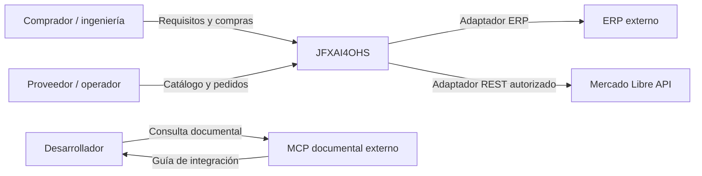
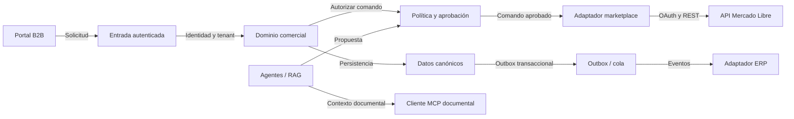
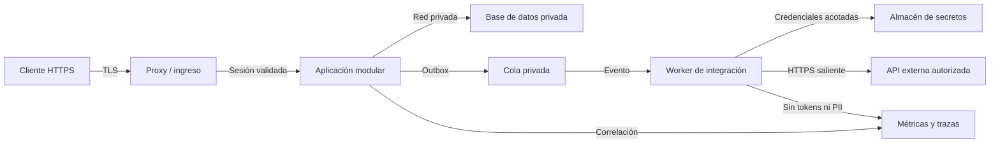
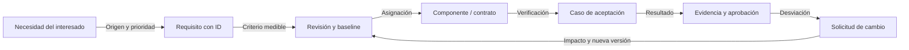

# Arquitectura de alto nivel

Baseline documental: 2026-10-10. Arquitectura propuesta; el repositorio no contiene implementación ejecutable.

## Contexto y límites

[Fuente Mermaid](mermaid/01-context.mmd) · [Editar en draw.io](drawio/01-context.drawio)

## Contenedores lógicos

[Fuente Mermaid](mermaid/02-containers.mmd) · [Editar en draw.io](drawio/02-containers.drawio)

## Sincronización y recuperación

[Fuente Mermaid](mermaid/03-sync.mmd) · [Editar en draw.io](drawio/03-sync.drawio)

```mermaid
flowchart LR
  source["ERP: stock confirmado"]
  outbox["Evento con versión"]
  worker["Worker por tenant"]
  policy["Permisos y capacidad"]
  adapter["Adaptador REST"]
  api["Marketplace"]
  retry["Reintento acotado"]
  dlq["Cola de fallos"]
  audit["Auditoría / conciliación"]
  source -->|"Commit"| outbox
  outbox -->|"Entrega al menos una vez"| worker
  worker -->|"Deduplicar y validar"| policy
  policy -->|"Permitido"| adapter
  adapter -->|"Actualizar stock"| api
  api -->|"Resultado confirmado"| audit
  adapter -->|"Timeout o error temporal"| retry
  retry -->|"Backoff y límite"| worker
  retry -->|"Agotamiento"| dlq
  dlq -->|"Intervención y conciliación"| audit
```

## Despliegue propuesto

[Fuente Mermaid](mermaid/04-deployment.mmd) · [Editar en draw.io](drawio/04-deployment.drawio)

## Ingeniería de requisitos

[Fuente Mermaid](mermaid/05-requirements.mmd) · [Editar en draw.io](drawio/05-requirements.drawio)

## Convenciones y mantenimiento

Las cinco vistas usan los mismos IDs y relaciones en Mermaid y draw.io. Mantener ambas representaciones juntas al modificar una vista. Los nodos representan responsabilidades lógicas; no obligan a desplegar microservicios. Las flechas documentales no autorizan transacciones. La vista de despliegue es una propuesta inicial, pendiente de decisiones de infraestructura.
